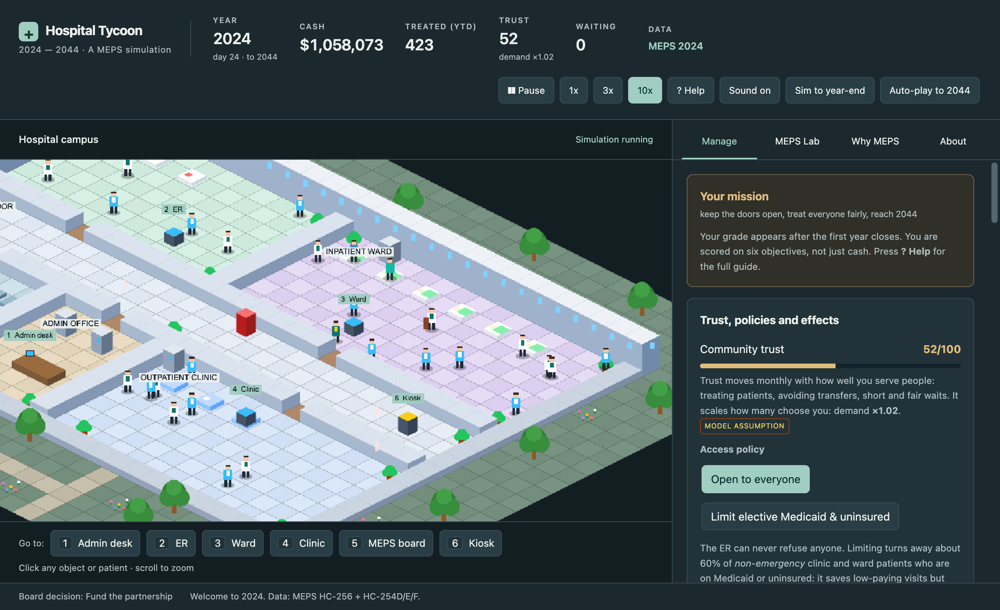

# Hospital Tycoon: 2044

An isometric pixel-art hospital management game where **the MEPS 2024 data is the teacher and the guide**. Patient demand, who arrives, and what they pay come from the Medical Expenditure Panel Survey (HC-256 plus event files HC-254D/E/F). It is a scenario game, not a forecast or clinical tool.

## How MEPS drives the game
- **Demand & payments:** every patient is sampled from survey-weighted (PERWT24F) cells by age, insurance and income; every visit's payment is drawn from MEPS payer-specific facility-payment distributions; inpatient stays use the MEPS nights distribution.
- **Yearly MEPS briefing:** each year you predict a real statistic (who uses the ER most, how skewed spending is, what payers pay, ...), then see the answer with its 95% design-based confidence interval and source variable. Correct answers earn a small data-literacy grant. Questions are generated from the loaded data, so they can never disagree with it.
- **Data Coach:** live advice that converts MEPS rates into capacity and finance guidance (expected arrivals, beds needed, payer-mix revenue, affordability).
- **MEPS Lab:** explore use rates by age, insurance and income with confidence intervals, plus spending concentration and a methods primer.
- **Why MEPS tab:** explains what the survey is, where each mechanic comes from, a live calculation of what happens if you ignore it (use-weighting, skew, payer), and its honest limits.
- **Reports:** year-end and final reports compare your patient mix to the MEPS population, show equity and affordability, a no-intervention comparison, and 20-seed variability bands.
- Every number is labelled MEPS_OBSERVED / MEPS_CALIBRATED / MODEL_ASSUMPTION / SIMULATED / DEMO_SYNTHETIC. Without the data asset the app runs in a clearly bannered DEMO mode.

## The datathon question
Built for the Biokind x UBSA 2026 Public Health Datathon, Track 2 (Healthcare Access): examine inequities in the economic burden of health care using MEPS HC-256. The headline finding: 18.3% (±3.2) of people in poor families spend over 10% of family income out of pocket versus 3.0% (±0.6) in high-income families, while spending fewer dollars. See [docs/CHALLENGE_ALIGNMENT.md](docs/CHALLENGE_ALIGNMENT.md) for the problem questions, techniques and where the product answers each, and `docs/presentation/` for the slides.



## Choices matter
Money is not automatic. Every year a **board meeting** puts one dilemma in front of you (a Medicaid rate cut, a nurse contract, new equipment, a free clinic, an insurer contract…) with real prices, lasting effects and sometimes risk, and doing nothing just selects the default. **Community trust** (0–100) updates monthly from how well you serve people and scales how many patients choose you, and an **access policy** lets you trade revenue against equity (the ER can never refuse anyone). Auto-play skips every decision to show what indecision costs.

## Goal and how to play
Run a community hospital from 2024 to 2044 and **keep it open and fair**: stay solvent, treat nearly everyone, keep the ER safe, give every insurance group similar care, and keep care affordable. You earn a letter grade on six weighted objectives (finance, access, emergency safety, equity, affordability, data IQ), not just cash. Press **? Help** in the game for the full guide, including what players should take away. Optional **Challenge mode** adds seeded yearly events (flu surge, recession, staffing shortage).

## Run
```
npm install
npm run dev        # http://localhost:5173
npm test           # 46 sim/data/teaching tests (vitest)
npm run build      # typecheck + production build
```
Controls: click an object on the map (or press 1–6) and the administrator walks there and opens its panel. Space pauses, M mutes, the wheel zooms.

## Rebuild the data asset from raw MEPS (the derived asset is committed)
```
python3 -m venv .venv && .venv/bin/pip install pandas pyreadstat numpy
.venv/bin/python scripts/fetch_meps.py      # downloads to data/raw (gitignored), writes data/source_manifest.json
npm run data                                # build_baseline.py + validate_baseline.py -> docs/DATA_REPORT.md
```
If the download is blocked, fetch the Stata zips manually and pass `--dataset HC-256 --local-zip PATH`.

## Presentation
`docs/presentation/Hospital-Tycoon-2044-Slides.pdf` is the 8-slide deck for the 4-minute talk (with a live-demo slide).

## Contributing
See [CONTRIBUTING.md](CONTRIBUTING.md). CI runs tests, type checks and the build on every push and pull request.

## Layout
`packages/sim` deterministic simulation + teaching engine · `packages/model-assets` derived MEPS JSON and `default-assumptions.json` · `apps/web` Vite + React + Phaser (isometric) · `scripts/` Python ETL · `docs/` methods, assumptions, data report.
